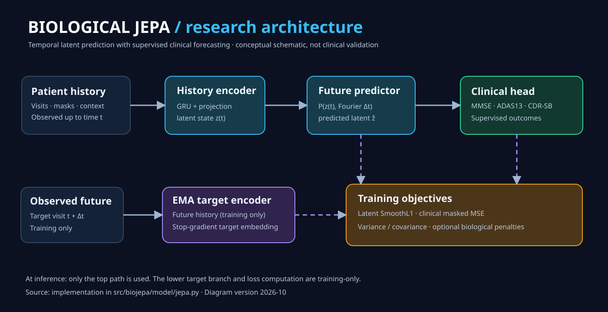
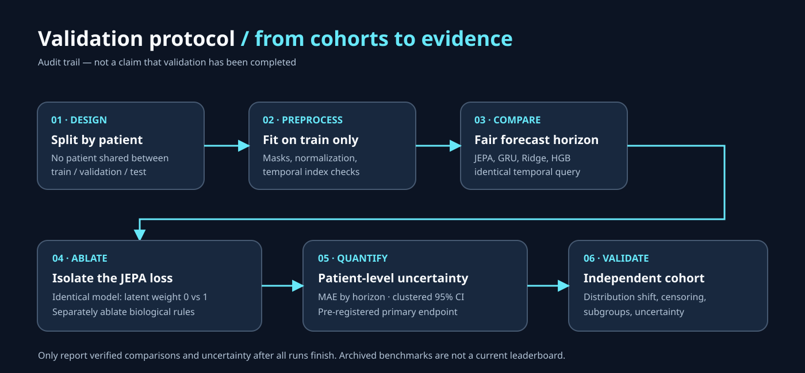

# Biological JEPA

**A research prototype for forecasting longitudinal Alzheimer's disease measurements through future latent representations.**

> **Research status — October 2026:** An audit corrected the statistics (patient-level inference instead of counting each patient once per seed), the conversion design, the GRU training budget, the rollout and rule-violation scoring and several code bugs. **All earlier numbers are superseded** and archived with the reasons in [`experiments/archive/2026-09_pre-audit/`](experiments/archive/2026-09_pre-audit/README.md). No benchmark result is claimed until the corrected pipeline is rerun on licensed data. This is **not** a clinically validated system.

## Why this project exists

Clinical records contain irregular follow-up visits, missing measurements, and uncertain trajectories. This project tests one precise hypothesis: **does a learned future-patient representation improve longitudinal clinical prediction beyond a matched, supervised model without a latent objective?**

The project combines a temporal context encoder, a forecast-horizon-conditioned latent predictor, an EMA target encoder used during training, a clinical regression head and optional soft biomedical constraints. These rules express assumptions; they do **not** establish causal disease mechanisms.

## Architecture



**During training:** the history encoder summarizes visits up to time t. The latent predictor forecasts a future embedding, trained against a no-gradient EMA target from observed future history. A clinical head predicts future MMSE / ADAS13 / CDR-SB, with optionally penalized violations of programmed constraints.

**During inference:** only observed patient history, forecast horizon, encoder, predictor and clinical head are used. Future observations and the target encoder are not required.

[Editable architecture SVG](docs/architecture.svg) · [Implementation](src/biojepa/model/jepa.py) · [Biological rule specification](docs/BIOLOGICAL_RULES.md)

## Evidence, clearly separated

| Status | What it means |
|---|---|
| Implemented | History-aware JEPA-inspired architecture, supervised clinical head, biological penalties; baselines get the same current-visit inputs and horizon (GRU also the history and the same training budget) |
| Implemented analysis plan | 5-fold × 3-seed subject-level CV, patient-level paired inference, prospective conversion design, latent-objective ablation with a matched supervised control |
| Tested in code | Rule-engine, statistics, conversion-design and leakage regression tests, plus an end-to-end run of every entry point on synthetic data |
| Superseded | All pre-audit ADNI / OASIS-2 numbers ([why](experiments/archive/2026-09_pre-audit/README.md)) |
| Still required | Rerun on licensed ADNI data, ADNI publication review, external validation |

[RESULTS.md](docs/RESULTS.md) is generated from the experiment artifacts by `scripts/make_results_md.py`; it contains no numbers until the corrected pipeline has been run.

## Evaluation protocol



A fair test needs: disjoint patient splits, transformations fit only to training patients, matched horizon-conditioned baselines, controlled ablations, uncertainty at patient level and an independent external cohort.

[Full research protocol](docs/RESEARCH_PROTOCOL.md) · [Editable validation graphic](docs/validation_protocol.svg)

## Reproduce the research pipeline

Requires Python 3.10+ and project dependencies. Datasets are not included.

```bash
git clone https://github.com/0ans/biological-jepa.git
cd biological-jepa
make setup
make test
```

Check the full pipeline on synthetic data (minutes on a laptop; a pipeline check, not evidence):

```bash
./.venv/bin/python -m biojepa.run_experiments --study synthetic --seeds 0 1 --folds 3
./.venv/bin/python scripts/latent_ablation.py --study synthetic --seeds 0 --folds 3
```

For the real analyses, first review [ADNI access](docs/ADNI_ACCESS.md). The ADNI loader currently reads the abaR-processed table (`data/raw/adnimerge_sample.rda`); data downloaded from LONI as the official `ADNIMERGE` table need a mapping step that is **not implemented yet**, and a file that differs from the pinned hash needs `--allow-unpinned`. Then:

```bash
make data            # OASIS-2 download + hash checks of your ADNI file
make cohort          # cohort table and conversion-design flow from the data
make experiments     # model comparison, conversion, stress and rollout tests
make ablation        # primary hypothesis: latent objective vs matched supervised control
make results         # regenerate docs/RESULTS.md from the artifacts
```

The latent-objective ablation compares the identical v2 architecture with the latent objective (`w_lat=1`, VICReg on) against a purely supervised control (`w_lat=w_std=w_cov=0`) over 5 folds × 3 seeds, with one pre-specified endpoint (default MMSE at 12 months) — fix it before looking at any result.

## Publication materials

- [Research manuscript draft](paper/MANUSCRIPT.md) — structured background, methods, limitations and explicit reporting status
- [Scientific submission checklist](paper/SUBMISSION_CHECKLIST.md) — remaining experiments, statistical validation and review requirements
- [Research protocol](docs/RESEARCH_PROTOCOL.md) — comparability, evaluation design and interpretation
- [Results](docs/RESULTS.md) — generated from the artifacts; empty until the corrected pipeline is rerun
- [Research log](docs/RESEARCH_LOG.md) — design decisions and failed attempts
- [Experiment artifacts](experiments/README.md) — provenance of run outputs and the pre-audit archive

## Repository guide

```text
src/biojepa/          model, data processing, objectives, evaluation, baselines
scripts/              data loading, patient inference, latent-loss ablation
tests/                unit, fairness and smoke tests
docs/                 transparent protocols, scientific context, SVG figures
experiments/          run outputs (after rerun) and the pre-audit archive
paper/                manuscript draft and submission quality gates
.github/workflows/    automated test checks
```

## Research and clinical limitations

Available ADNI-derived data have restricted longitudinal biomarker coverage, and OASIS-2 is relatively small. Irregular visits and missingness may not be random. Conversion analyses require careful event-time and censoring handling. A low score on **coded** biological rules is not validation of causal biology. This software is not intended for patient care, diagnosis, or treatment decisions.

## Attribution

Cite as research software pending a verified manuscript. Model inspiration includes I-JEPA and VICReg; datasets include ADNI and OASIS-2. Publications using ADNI data must follow the ADNI Data Use Agreement (manuscript review by the ADNI Data and Publications Committee and the standard acknowledgement); verify bibliographic details and all data-use terms before submission.

## License

MIT — [LICENSE](LICENSE).
